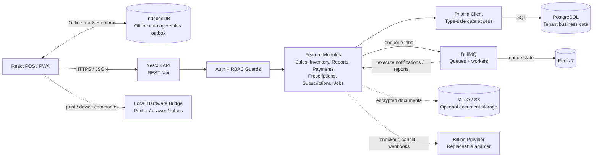
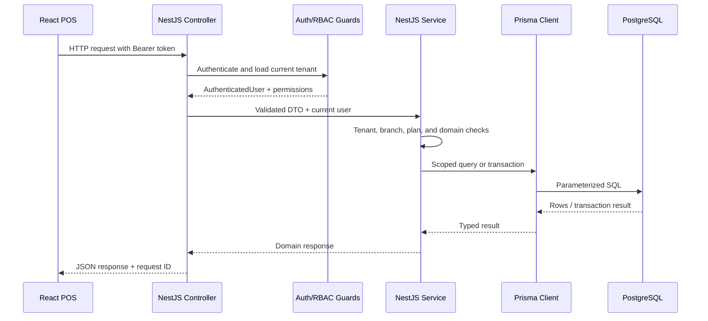
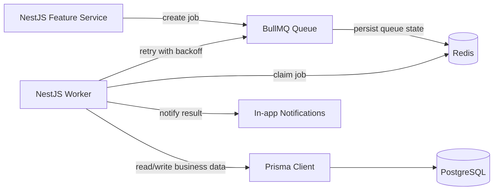

# System Connections

## Runtime Architecture



## Request Flow



## Background Job Flow



Examples of background work include low-stock checks, expiry checks, daily summaries, scheduled reports, and large report exports.

## Data Responsibilities

| Component | Responsibility | Should not own |
|---|---|---|
| React/PWA | POS interaction, offline cache, sales outbox, install experience | Authorization or final stock decisions |
| IndexedDB | Temporary offline catalog and queued sales | Authoritative inventory or permissions |
| NestJS controllers | HTTP routing, DTO transport, response status | Core business rules |
| NestJS guards | Authentication and permission enforcement | Database mutations |
| NestJS services | Tenant rules, pharmacy rules, transactions, orchestration | Browser-only state |
| Prisma | Type-safe persistence and transactions | UI or queue orchestration |
| PostgreSQL | Authoritative tenant, financial, inventory, and audit data | Ephemeral queue state |
| Redis | BullMQ queue state, retries, and job coordination | Durable business records |
| BullMQ workers | Deferred and retryable work | User authentication decisions |
| MinIO/S3 | Optional encrypted document/object storage | Relational reporting data |
| Billing provider | External subscription/payment lifecycle | Product or inventory rules |
| Hardware bridge | Local printer/drawer/label commands | Server-side authorization |

## Important Boundaries

- PostgreSQL is the source of truth for sales, inventory, payments, subscriptions, permissions, and audit logs.
- Redis is not a replacement for PostgreSQL; losing Redis should not erase business records.
- Prisma is the only normal database access path for NestJS services.
- Every tenant-owned Prisma query must include `tenantId`; branch-sensitive queries must also restrict `branchId`.
- Redis/BullMQ jobs must carry tenant context and use idempotency/deduplication keys.
- The browser may queue an offline sale, but the API revalidates permissions, subscription status, prescription rules, and stock before committing it.
- MinIO/S3 and billing are optional external boundaries and are accessed through replaceable adapters.
- Hardware commands must remain behind an authenticated local bridge; browser UI visibility is not authorization.

## Local Docker Connections

```text
Browser :5173
    |
    | HTTP API calls
    v
NestJS API :3000
    |                         \
    | Prisma / SQL              | BullMQ connection
    v                          v
PostgreSQL :5432           Redis :6379
    |
    | optional object storage profile
    v
MinIO :9000 / Console :9001
```

The API uses `DATABASE_URL` for PostgreSQL and `REDIS_URL` for Redis. The optional storage profile is configured through the S3-compatible environment variables in `.env.example`.
